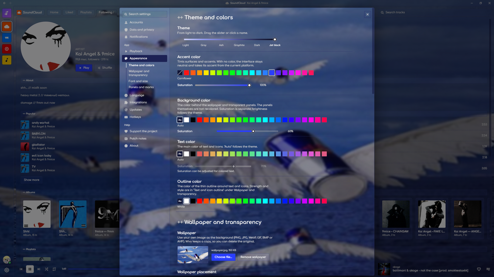

# Wivy

**Customizable player and aggregator of music services.**
All your music from SoundCloud, VK Music, YouTube Music and Yandex Music — in one place, in a design that is entirely yours.

**English** | [Русский](README.ru.md)

README last updated: 19.11.2026

---

## About

Wivy is a desktop music player built on Electron. Instead of switching between browser tabs and apps, you connect your accounts once and get your libraries, likes and playlists from every service in a single window with a single queue.

The main idea is **customization**: wallpaper, transparency, glass effect, fonts, colors, panel patterns, interface language — almost everything can be adjusted to your taste.

## Screenshots

| Home page | Track page |
| :---: | :---: |
|  |  |

| Settigns | Search |
| :---: | :---: |
|  |  |

## Features

- **Music aggregator** — SoundCloud, VK Music, YouTube Music and Yandex Music in one app. The "All tracks" tab merges your liked tracks from every connected service, and each track is marked with its platform icon.
- **Library sync** — liked tracks, playlists, followed artists and recently added tracks.
- **Music Quality** — the best sound quality tracks available from the platforms.
- **Clips** — clips in the original quality from the platforms (as high as your internet speed allows).
- **Track, artist and playlist pages** — tags, related tracks, and quick links to open the item on the original service.
- **Multi-service Search** — search through all streaming services at once.
- **Queue** — drag and drop reordering, shuffle, repeat (playlist / single track).
- **Deep appearance customization**
  - themes, accent color and saturation, text color
  - your own wallpaper with placement modes, blur and glass effect
  - transparency of interface panels
  - text and icon outline for readability on busy wallpapers
  - fonts (including your own from the `fonts` folder) and interface scale
  - panel patterns and platform-marker display modes
- **Localization** — English by default, other languages are loaded from files in `locales` (you can add your own).
- **Hotkeys** and playback settings.
- **Custom window** — own title bar and window controls.

## Supported services

| Service | Status |
| :--- | :---: |
| SoundCloud | ✅ |
| VK Music | ✅/🚧(some bug, not so critical) |
| YouTube Music | 🚧 |
| Yandex Music | 🚧 |

> Support for the services marked 🚧 is under active development and may be incomplete or dont exists now.

## Download

Wivy is distributed only through [GitHub Releases](https://github.com/Ivyrker/Wivy/releases).

**[DOWNLOAD HERE](https://github.com/Ivyrker/Wivy/releases/latest)** Wivy can self-update if it turned on in settings

## Usage

1. Launch Wivy.
2. Connect your accounts in **Settings**.
3. Wait for the library to sync — your likes, playlists and artists will appear in the tabs.
4. Open **Settings** (the gear at the bottom of the sidebar) → **Appearance** to make the player look the way you want.

## Localization

Interface languages are stored as JSON files in the [`AppData\Roaming\Wivy\languages`](languages) folder. To add a translation, copy the English file, translate the values and put it there.

## Contributing

Bug reports and ideas are welcome. If you found a problem you can [open an issue](https://github.com/Ivyrker/Wivy/issues) and describe the steps to reproduce it (a screenshot helps).

## Support the project

If you like Wivy, you can support the project: leave a ⭐ on the repository, tell your friends about it, or use the *Support the project* section in the app's settings.

## Disclaimer

Wivy is an independent project and is not affiliated with, endorsed by or sponsored by SoundCloud, VK, YouTube, Google or Yandex. All trademarks and service names belong to their respective owners. Please respect the terms of service of the platforms you use and the rights of artists.

## License

Distributed under the **GNU General Public License v3.0**. See [LICENSE](LICENSE) for details.
