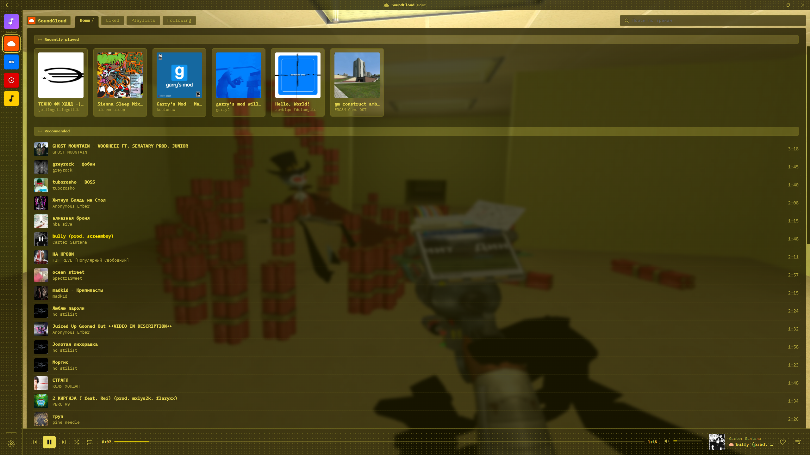
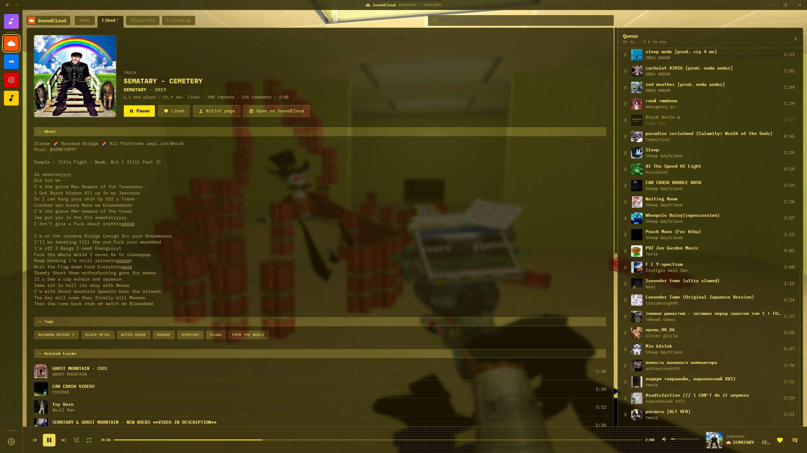
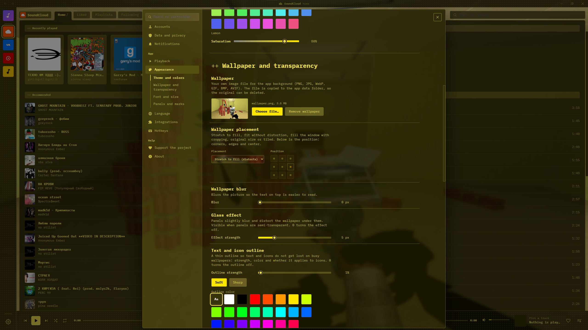

# Wivy

**Настраиваемый плеер и агрегатор музыкальных сервисов.**
Вся ваша музыка из SoundCloud, VK Музыки, YouTube Music и Яндекс Музыки — в одном месте и в оформлении, которое вы выбираете сами.

[English](README.md) | **Русский**

README обновлён: 14.11.2026

---

## О проекте

Wivy — десктопный музыкальный плеер на Electron. Не нужно переключаться между вкладками браузера и приложениями: подключите аккаунты один раз и получите библиотеки, лайки и плейлисты всех сервисов в одном окне и в одной очереди.

Главная идея — **кастомизация**: обои, прозрачность, эффект стекла, шрифты, цвета, узоры панелей, язык интерфейса — почти всё можно настроить под себя.

## Скриншоты

| Главная | Страница трека | Настройки |
| :---: | :---: | :---: |
|  |  |  |

## Возможности

- **Агрегатор музыки** — SoundCloud, VK Музыка, YouTube Music и Яндекс Музыка в одном приложении. Вкладка «Все треки» объединяет понравившиеся треки со всех подключённых сервисов, а каждый трек помечен иконкой своей платформы.
- **Синхронизация библиотеки** — лайки, плейлисты, подписки и недавно добавленные треки.
- **Страницы треков, артистов и плейлистов** — теги, похожие треки и быстрые ссылки на оригинал в сервисе.
- **Очередь** — перетаскивание, перемешивание, повтор (плейлист / один трек).
- **Глубокая настройка внешнего вида**
  - темы, акцентный цвет и насыщенность, цвет текста
  - свои обои с режимами размещения, размытием и эффектом стекла
  - прозрачность элементов интерфейса
  - обводка текста и иконок для читаемости на красочных обоях
  - шрифты (в том числе свои из папки `fonts`) и масштаб интерфейса
  - узоры панелей и режимы отображения метки платформы
- **Локализация** — по умолчанию английский, остальные языки загружаются из файлов в `locales` (можно добавить свой).
- **Горячие клавиши** и настройки воспроизведения.
- **Собственное окно** — своя верхняя панель и кнопки окна.

## Поддерживаемые сервисы

| Сервис | Статус |
| :--- | :---: |
| SoundCloud | ✅ |
| VK Музыка | ✅ |
| YouTube Music | 🚧 |
| Яндекс Музыка | 🚧 |

> Поддержка сервисов с пометкой 🚧 находится в активной разработке и может быть неполной.

## Загрузка

Wivy распространяется только через [GitHub Releases](https://github.com/Ivyrker/Wivy/releases).

> **Релизов пока нет.** Первая сборка появится там, как только будет готова — поставьте звезду или подпишитесь на репозиторий, чтобы не пропустить.

## Использование

1. Запустите Wivy.
2. Нажмите на иконку сервиса в левой панели и подключите аккаунт.
3. Дождитесь синхронизации — лайки, плейлисты и артисты появятся во вкладках.
4. Откройте **Настройки** (шестерёнка внизу левой панели) → **Внешний вид**, чтобы настроить плеер под себя.

## Локализация

Языки интерфейса хранятся в JSON-файлах в папке [`locales`](locales). Чтобы добавить перевод, скопируйте английский файл, переведите значения и отправьте pull request — или просто положите файл в папку для личного использования.

## Участие в разработке

Баг-репорты, идеи и pull request'ы приветствуются. Если нашли проблему, [создайте issue](https://github.com/Ivyrker/Wivy/issues) и опишите шаги воспроизведения (скриншот поможет).

## Поддержать проект

Если Wivy вам нравится, можно поддержать проект: поставьте ⭐ репозиторию, расскажите друзьям или загляните в раздел *«Поддержать проект»* в настройках приложения.

## Отказ от ответственности

Wivy — независимый проект, не связанный и не спонсируется SoundCloud, VK, YouTube, Google и Яндекс и другими стриминговыми сервисами. Все товарные знаки и названия сервисов принадлежат их владельцам. Соблюдайте условия использования платформ и уважайте права авторов.

## Лицензия

Распространяется по лицензии **GNU General Public License v3.0**. Подробнее — в файле [LICENSE](LICENSE).
